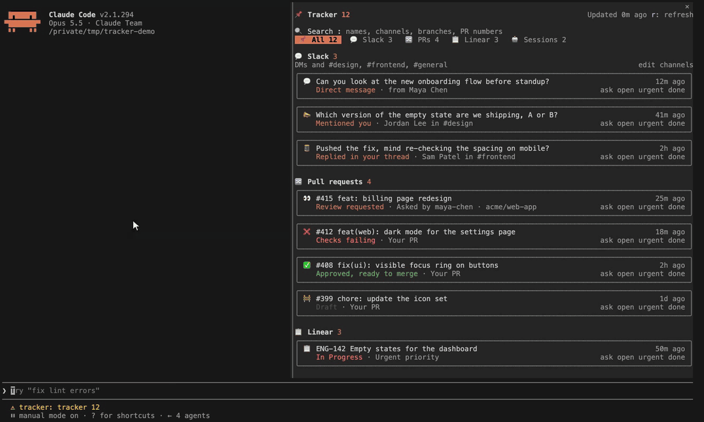

# /tracker for Claude Code

A live pane inside Claude Code that shows everything waiting on **you**, in one place, refreshed by itself while you work.



## Install

In a Claude Code terminal session:

```
/plugin install tracker --marketplace Peleg770/claude-tracker
```

Answer `y` to add the marketplace, pick the user scope, and type `/tracker`.

## What it shows

| Section | What lands there |
| --- | --- |
| 💬 **Slack** | DMs where the last message is someone else's, mentions of you in the channels you watch, and threads you posted in where someone replied after you. Bots are skipped. |
| 🔀 **Pull requests** | Your open PRs and where they stand (checks failing, changes requested, draft, checks running, approved and ready to merge, waiting for review), plus PRs where your review is requested. |
| 📋 **Linear** | Issues assigned to you that are started or not yet started, urgent and high priority first. |
| 📧 **Gmail** | Unread threads in your primary inbox from the last 7 days. |
| 📅 **Calendar** | Invites you have not answered in the next 14 days, and meetings starting within the hour. |
| 🎫 **Jira** | Issues assigned to you that are not done, across every Atlassian site you can reach, highest priority first. |
| 🤖 **Claude sessions** | Your other Claude Code sessions that went idle and are waiting for you, with their last prompt. |

Every row has four actions:

- **ask** puts a ready prompt in your prompt box ("Help me reply to Maya on Slack", "Get this PR ready to merge"), so Claude picks it up in one keystroke.
- **open** opens it in your browser.
- **urgent** pins it to the Urgent tab.
- **done** hides it until something new happens on it. Done rows stay in the Done tab for 48 hours, so you can undo.

There is also a search box, `r` to refresh, and a channel editor for the Slack channels you watch.

Connected sources refresh every 5 minutes, sessions every 20 seconds. On a wide terminal (144 columns or more) the pane opens by itself when a session starts; `/tracker` opens it anytime and `/tracker refresh` forces a refresh.

## Supported sources

Nothing to configure. On every refresh the tracker looks at the MCP servers you have connected (claude.ai Settings, Connectors, or `/mcp`) and reads only the ones it knows; the rest never appear, not even as an empty section. Connect one later and it shows up on the next refresh.

| Source | Found when |
| --- | --- |
| 💬 Slack | the Slack connector on claude.ai or any Slack MCP server with `slack_search_public_and_private` |
| 📋 Linear | the Linear connector or the Linear MCP server (`list_issues` on a server with `linear` in its name) |
| 🎫 Jira | the Atlassian connector or the Atlassian MCP server (`searchJiraIssuesUsingJql`) |
| 📧 Gmail | the Gmail connector or Google's Gmail MCP server (`search_threads` on a server with `gmail` in its name) |
| 📅 Google Calendar | the Google Calendar connector or Google's Calendar MCP server (`list_events` on a server with `calendar` in its name) |
| 🔀 GitHub pull requests | the GitHub CLI signed in (`gh auth status`), not an MCP server. Your own PRs come from the repo of the folder you start Claude Code in; review requests are searched across GitHub. |
| 🤖 Claude sessions | always on: read from your own `~/.claude` folder |

Servers are found by their tools, not their names, so whatever yours is called in `/mcp` works. A source that is connected but fails is named once at the foot of the pane, and the rest keep working. Watched Slack channels start empty: add yours from the pane. DMs always count.

Everything is about whoever runs it: your Slack user, `gh` as you, issues assigned to you. Nothing is sent anywhere except the services you already connected.

## Add any MCP you use

The list above is what ships, not a limit. Any MCP server can become a source: Asana, GitLab, Notion, Sentry, your company's internal one. Each source is two small pieces:

1. an entry in `MCP_SOURCES` (`hooks/parse.ts`): the tool that tells the tracker the server is connected
2. a loader in `hooks/register.tsx`: which tool to call, with what arguments ("assigned to me", "not done"), and how each result becomes a row

The easiest way: connect the server, set up your own copy (below), and ask Claude in that folder, for example *"Add Asana to the tracker: my incomplete tasks, due soonest first."* Claude can read the server's real tools from your session and write the loader against them. Pull requests for new sources are welcome.

## Make it yours

`/plugin install` gives you a copy that updates with `claude plugin update`. To change it, clone the repo and run it from your folder:

```bash
git clone https://github.com/Peleg770/claude-tracker ~/claude-tracker
claude plugin marketplace add ~/claude-tracker
claude plugin install tracker@claude-tracker --scope user
```

Claude Code then reads the mod straight from that folder: edit it (or ask Claude to) and run `/reload-plugins`. The knobs at the top of `hooks/register.tsx`:

- `REMOTE_EVERY_MS`: how often connected sources refresh (5 minutes)
- `SESSIONS_EVERY_MS`: how often idle sessions are checked (20 seconds)
- `SLACK_DAYS`: how far back Slack is searched (7 days)
- `SHOWN_PER_SECTION`: rows per section before "show more" (5)

Check your changes with `claude plugin validate .` and `claude plugin test .`.

## Remove it

```
claude plugin uninstall tracker@claude-tracker
```

## License

MIT
